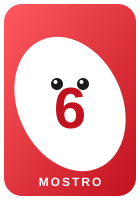
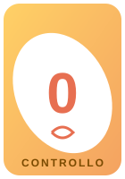
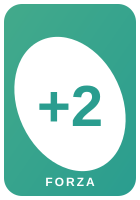

# 👾 Uno Mostro

> **Play Magic the Gathering with UNO cards!**

Uno Mostro was born to introduce my kids (then 8 and 9 years old) to card games and math.

Grab a deck of UNO cards, flip the rules, and turn it into a real battle game: the numbered cards become **monster creatures**, the special cards become **spells and tricks**. Easy to learn, exciting to play, perfect for the whole family.

## 🎯 In a nutshell

- Each player has **100 Life Points** and starts with **7 cards** in hand.
- Monsters have **Strength** and **Resistance** equal to their number.
- You can attack and defend with **any color**: 🔴 🔵 🟢 🟡
- Bring your opponents down to **0** life points: the **last one standing** wins!

## 🃏 The cards

| 👾 Monster | 🧠 0 | 🔄 Change Turn | 💪 +2 |
|:---:|:---:|:---:|:---:|
|  |  |  |  |
| Attacks and defends with strength = number | Control an opponent's monster for 1 turn | Steal an opponent's monster forever | +2 Strength and Resistance |

| 💥 +4 | 🎨 Change Color | 🚫 Ban |
|:---:|:---:|:---:|
|  |  |  |
| +4 Strength and Resistance (max 1) | Destroy a monster or a power-up | Stop a monster from attacking |

## 📖 Full rules

- 🇬🇧 [Rules (English)](RULES.md)
- 🇮🇹 [Regolamento (Italiano)](REGOLAMENTO.md)

## ✍️ Credits

Game created by **Andres Zanzani**.

> ⚠️ For any commercial use, please contact me!

---

*Play and have fun! 👾*
