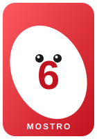
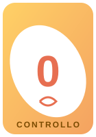
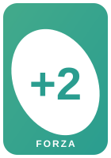

# 👾 Uno Mostro

> **Gioca a Magic the Gathering con le carte da UNO!**

Uno Mostro nasce per avvicinare i miei figli (allora di 8 e 9 anni) ai giochi di carte e alla matematica.

Prendi un mazzo di carte UNO, ribalta le regole e trasformalo in un vero gioco di battaglie: le carte numerate diventano **creature mostro**, le carte speciali diventano **incantesimi e trucchi**. Semplice da imparare, avvincente da giocare, perfetto in famiglia.

## 🎯 In breve

- Ogni giocatore ha **100 Punti Vita** e parte con **7 carte** in mano.
- I mostri hanno **Forza** e **Resistenza** pari al loro numero.
- Puoi attaccare e difendere con **qualsiasi colore**: 🔴 🔵 🟢 🟡
- Porta a **0** i punti vita degli avversari: vince **l'ultimo che resta**!

## 🃏 Le carte

| 👾 Mostro | 🧠 0 | 🔄 Cambia Turno | 💪 +2 |
|:---:|:---:|:---:|:---:|
|  |  |  |  |
| Attacca e difende con forza = numero | Controlli un mostro avversario per 1 turno | Rubi un mostro avversario per sempre | +2 Forza e Resistenza |

| 💥 +4 | 🎨 Cambia Colore | 🚫 Divieto |
|:---:|:---:|:---:|
|  |  |  |
| +4 Forza e Resistenza (max 1) | Distruggi un mostro o un potenziamento | Blocca l'attacco di un mostro |

## 📖 Regolamento completo

- 🇮🇹 [Regolamento (Italiano)](REGOLAMENTO.md)
- 🇬🇧 [Rules (English)](RULES.md)

## ✍️ Credits

Gioco creato da **Andres Zanzani**.

> ⚠️ Per qualsiasi uso commerciale, contattatemi!

---

*Giocate e divertitevi! 👾*
